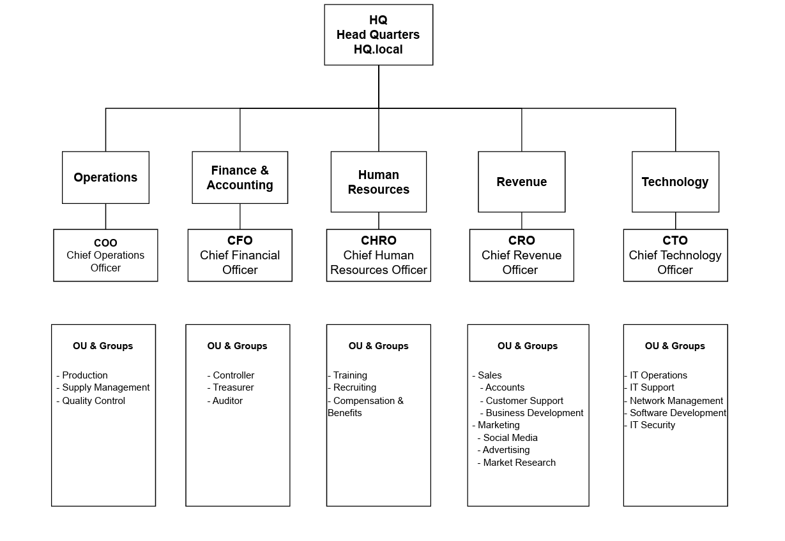
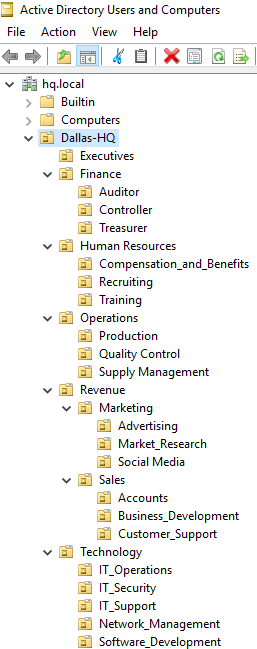
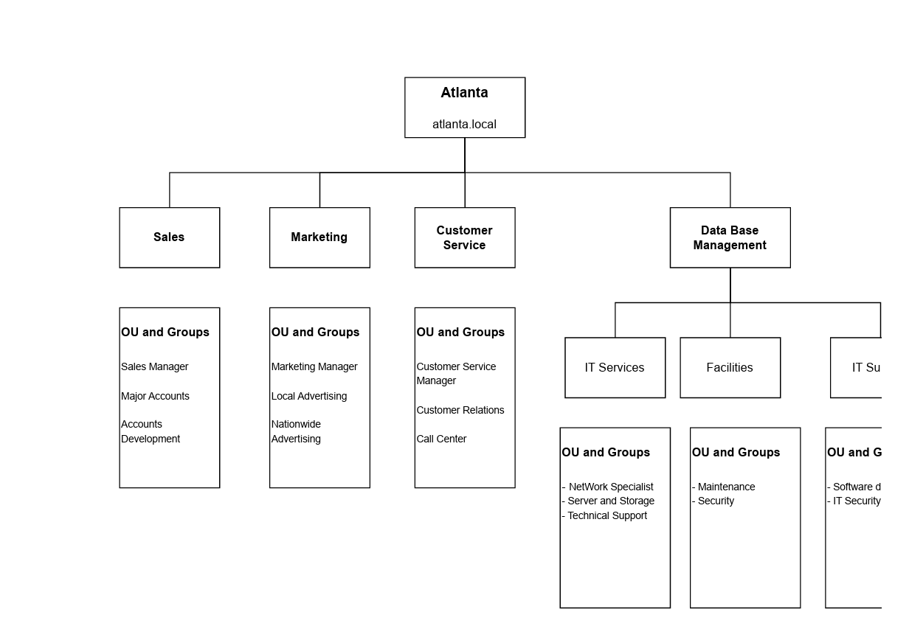
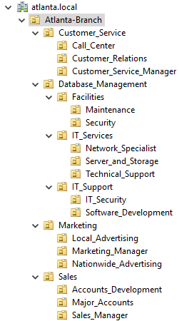
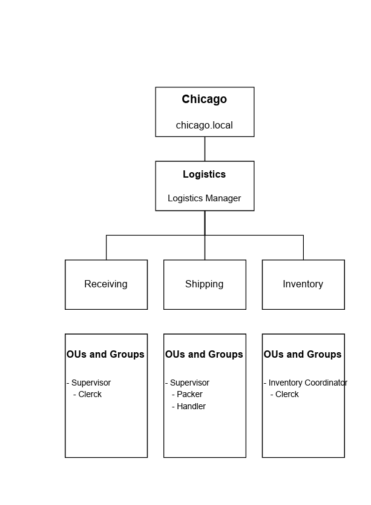
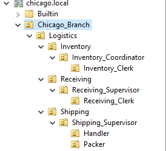
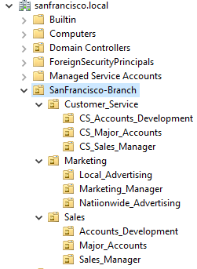
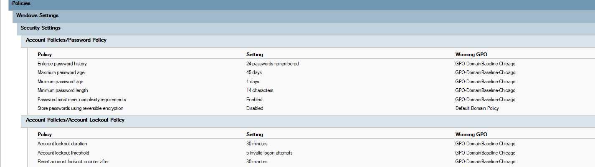
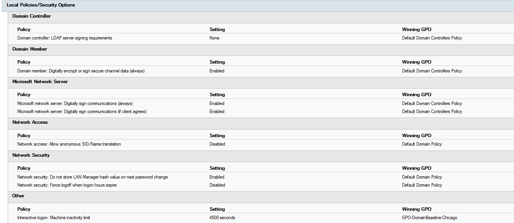

# Enterprise Active Directory Lab

A multi-site Windows Server Active Directory environment designed to simulate the identity and access management infrastructure of an organization with multiple geographic locations.

The project involved designing organizational structures, creating Active Directory organizational units and groups, configuring Group Policy security settings, and administering Windows Server services across multiple locations.

## Project Overview

The environment was designed around a headquarters and multiple branch locations, including:

- Headquarters (HQ)
- Atlanta
- Chicago
- San Francisco
- Milwaukee
- Seattle
- Austin

Each location was organized based on its business functions and required its own Active Directory structure.

## Technologies & Skills

- Windows Server
- Active Directory Domain Services (AD DS)
- PowerShell
- Group Policy
- Organizational Units (OUs)
- Active Directory Groups
- Identity and Access Management
- DHCP
- NTFS Permissions
- L2TP/IPsec VPN
- Windows Server Administration

## Active Directory Design

Organizational structures were planned around departments and job functions before being implemented in Active Directory.

### Headquarters

HQ was divided into major business departments including Operations, Finance & Accounting, Human Resources, Revenue, and Technology.

The planned structure was then implemented using organizational units and groups in Active Directory.

### Atlanta Branch

The Atlanta location included Sales, Marketing, Customer Service, Database Management, IT Services, Facilities, and IT Support functions.

### Chicago Branch

The Chicago location focused on logistics operations, including Receiving, Shipping, and Inventory.

### Additional Locations

Additional Active Directory structures were configured for other branch locations, including San Francisco, Milwaukee, Seattle, and Austin.

The San Francisco implementation is shown below as another example of the branch structure.

## Group Policy & Security

Group Policy was used to apply security settings across the environment.

Configured password and account lockout controls included:

- 24-password history
- 45-day maximum password age
- 1-day minimum password age
- 14-character minimum password length
- Password complexity requirements
- Account lockout after 5 invalid logon attempts
- 30-minute account lockout duration
- 30-minute lockout counter reset

Additional Windows security settings were also configured through Group Policy, including network and domain security options.

## PowerShell Automation

PowerShell was used during the project to create and manage Active Directory organizational units, users, and groups. This reduced repetitive manual configuration when building the directory structure.

## Additional Configuration

The larger lab environment also included:

- DHCP configuration for network services
- NTFS permissions for controlling access to resources
- Group Policy Objects (GPOs)
- L2TP/IPsec VPN configuration for remote access

## Skills Demonstrated

- Active Directory administration
- Windows Server administration
- PowerShell automation
- Organizational Unit design
- User and group management
- Group Policy configuration
- Password and account lockout policies
- Identity and access management
- NTFS permissions
- DHCP configuration
- VPN configuration
- Multi-site enterprise infrastructure planning

## Project Context

This project was completed as a group-based academic lab designed to simulate the administration of a multi-location enterprise Windows environment.

The repository documents the architecture and configuration using diagrams and screenshots from the completed lab environment.